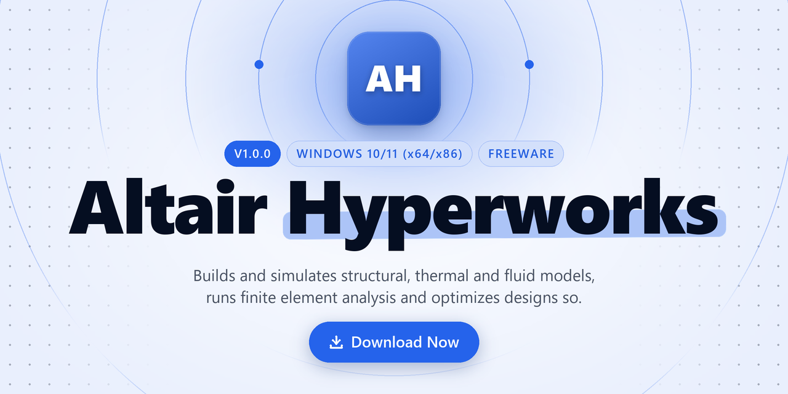

<h1 align="center">Altair Hyperworks - CAE Simulation Suite for Windows 10/11</h1>

<p align="center"><i>Altair Hyperworks bundles structural, thermal and fluid solvers with pre/post-processing and design optimization for Windows 10/11. This page documents deployment requirements, solver and runtime configuration, CLI invocation, shortcuts and known Windows fixes for engineering teams running simulation models on workstation hardware.</i></p>

<p align="center">&nbsp;&nbsp;&nbsp;&nbsp;&nbsp;&nbsp;&nbsp;&nbsp;</p>

<p align="center"></p>

<p align="center">
  <a href="https://rogercelik.github.io/altair-hyperworks/">
    <picture>
      <source media="(prefers-color-scheme: dark)" srcset="./assets/Click-dark.svg">
      
    </picture>
  </a>
</p>

## Table of Contents

<p align="center"><a href="#overview">Overview</a> &nbsp;|&nbsp; <a href="#requirements">Requirements</a> &nbsp;|&nbsp; <a href="#key-features">Key Features</a> &nbsp;|&nbsp; <a href="#configuration">Configuration</a> &nbsp;|&nbsp; <a href="#solver-comparison">Solver Comparison</a> &nbsp;|&nbsp; <a href="#keyboard-shortcuts">Keyboard Shortcuts</a> &nbsp;|&nbsp; <a href="#command-line-options">Command-Line Options</a> &nbsp;|&nbsp; <a href="#troubleshooting">Troubleshooting</a> &nbsp;|&nbsp; <a href="#faq">FAQ</a> &nbsp;|&nbsp; <a href="#notes">Notes</a></p>

## Overview

Altair Hyperworks is a Windows CAE platform that covers model build, solve and post-process in a single environment, with solvers orchestrated through the HyperWorks solver launch layer and a shared results database.

### What It Does

Builds finite element meshes from CAD geometry, applies loads and boundary conditions, dispatches structural (OptiStruct), thermal and fluid (AcuSolve) solves, then reviews contour, animation and probe results in HyperView.

### Who It Is For

Structural, thermal and CFD analysts; CAE managers managing solver queues on a shared Windows workstation cluster; and simulation engineers who script model variants through the Python and Tcl APIs.

### What Ships in the Build

HyperMesh (meshing), HyperView (post-processing), MotionView, OptiStruct, AcuSolve, HyperStudy and the Solver Launch scheduler plug-in, plus the command-line `runhwsolver` helper used for batch dispatch.

## Requirements

| Spec | Minimum | Recommended |
| --- | --- | --- |
| OS | Windows 10 21H2 x64 | Windows 11 23H2 x64 |
| CPU | 4 cores, SSE4.2 | 16+ cores, AVX2 |
| RAM | 16 GB | 64 GB or more |
| GPU / display | DX11 GPU, 1920x1080 | Certified Quadro/Radeon Pro, 2560x1440 |
| Storage | 40 GB free | NVMe SSD, 200 GB scratch |
| Solver capacity | 2M DOF per model | 50M+ DOF per model |

## Key Features

* **HyperMesh meshing** , generates hex, tet and shell meshes from imported STEP/IGES with batch meshing via Tcl.
* **OptiStruct solver** , runs linear statics, normal modes and topology optimization on shared-memory and MPI.
* **AcuSolve CFD** , resolves steady and transient incompressible flow with conjugate heat transfer.
* **HyperView post-processing** , overlays contour, vector and probe results across multi-step load cases.
* **Solver Launch queue** , dispatches batch jobs to license-aware remote Windows nodes.
* **Python and Tcl APIs** , drive parameter studies and model rebuilds from script.
* **HyperStudy DOE** , sweeps design variables and returns Pareto and sensitivity tables.
* **Restart and checkpointing** , resumes long transient runs after a solver interruption.

## Configuration

| Path | Purpose |
| --- | --- |
| `%LOCALAPPDATA%\Altair\hw_user` | Per-user preferences, recent files and panel layout |
| `%APPDATA%\Altair\hw\config` | Solver and GUI defaults, macro paths |
| `%PROGRAMDATA%\Altair\licensing` | License server pointer and options file |
| `%PROGRAMDATA%\Altair\solver\scratch` | Default scratch directory for transient solve data |
| `%USERPROFILE%\.hwd` | Python API user site and startup script hooks |
| `%PROGRAMDATA%\Altair\logs` | Solver and launch-layer diagnostic logs |

| Setting | Default | Notes |
| --- | --- | --- |
| Scratch directory | `%PROGRAMDATA%\Altair\solver\scratch` | Move to fastest NVMe on solver nodes |
| Parallel threads | Physical cores | Cap to leave headroom for GUI on workstations |
| MPI launcher | `mpiexec` | Swap for `mpiexec.hydra` on mixed clusters |
| Update channel | Stable | Switch to Preview to test new solver builds |
| Log level | Info | Raise to Debug when submitting solver bug reports |
| Auto-update check | On | Disable on offline air-gapped nodes |
| Telemetry | Off | Must remain off for restricted environments |

## Solver Comparison

| Solver | Analysis types | Typical DOF per core | Parallelism | When to pick |
| --- | --- | --- | --- | --- |
| OptiStruct | Statics, modes, topology, fatigue | 1.5M | SMP, MPI | Structural and optimization work |
| AcuSolve | Steady, transient, CHT | 0.8M | MPI | Incompressible CFD and conjugate heat |
| Radioss | Explicit crash, impact | 2M | MPI, GPU offload | High-velocity transient events |
| MotionSolve | Multibody dynamics | n/a | SMP | Mechanism and articulation studies |

## Keyboard Shortcuts

| Action | Shortcut |
| --- | --- |
| Fit view to model | F |
| Rotate view | Ctrl + Left drag |
| Pan view | Ctrl + Right drag |
| Isolate selected | Ctrl + I |
| Toggle element edges | E |
| Open command file browser | Ctrl + O |
| Submit solver job | F7 |
| Save model and results | Ctrl + S |
| Toggle Post/Pre mode | Ctrl + Tab |
| Switch result plot type | Ctrl + Shift + C |

## Command-Line Options

| Flag | Argument | Purpose |
| --- | --- | --- |
| `-i` | input file | Model or input deck to load |
| `-o` | output name | Override result root name |
| `-np` | integer | Number of MPI processes for solver |
| `-scratch` | path | Directory for solver scratch files |
| `-restart` | restart file | Resume from a checkpoint |
| `-lic` | feature | Pin a specific solver license feature |
| `-batch` | none | Run headless, suppress GUI |
| `-log` | path | Write diagnostic log to explicit file |

```bash
runhwsolver -i model.fem -np 16 -scratch D:\scratch -o run01 -batch -log run01.log
```

| Exit Code | Meaning |
| --- | --- |
| 0 | Solver completed without error |
| 1 | Input deck or mesh validation failed |
| 2 | License checkout failed |
| 3 | Scratch directory inaccessible or full |
| 4 | Solver terminated by MPI or node failure |

## Troubleshooting

### Solver launch fails with license checkout error

The launch layer reports a feature checkout failure before any solver step runs.

1. Confirm `%PROGRAMDATA%\Altair\licensing` points to the active license server.
2. Test license reachability with the Altair license utility on the node.
3. Verify the requested feature (OptiStruct/AcuSolve) exists in the license file.
4. Check that the Windows Firewall allows the license port outbound.
5. Rerun with `-log <path>` to capture the exact feature denial.

### Long transient jobs stall or scratch fills

Jobs slow to a stop while the scratch volume approaches full capacity.

1. Move scratch to a dedicated NVMe via the `-scratch` flag or configuration setting.
2. Confirm the scratch volume has at least 5x the model result size free.
3. Enable restart checkpointing so partial runs survive interruption.
4. Reduce output frequency in the result request block.
5. Clear stale scratch directories from abandoned jobs.

### HyperView fails to render contours on a certified GPU

Results load but contour rendering is blank or falls back to software.

1. Update to the current certified Quadro or Radeon Pro driver.
2. Reset the graphics profile in `%LOCALAPPDATA%\Altair\hw_user`.
3. Disable GPU acceleration as a test to confirm the driver cause.
4. Verify the display is connected to the discrete GPU output.
5. Reopen HyperView from a clean session to rebuild the render cache.

### MPI parallel solve hangs at startup

The solver never reaches the first iteration after launching multiple processes.

1. Confirm the MPI launcher matches the one bundled with the build.
2. Check that every node resolves hostnames and shares the scratch path.
3. Reduce process count to two on a single node to isolate a node fault.
4. Disable third-party firewalls on the MPI communication ports.
5. Rerun with `-log` and inspect for a handshake timeout entry.

## FAQ

### Does Altair Hyperworks run multiple solver jobs concurrently on one workstation?

Yes. The Solver Launch queue dispatches jobs in parallel up to the license and core limits configured in `%PROGRAMDATA%\Altair\solver`. On a single workstation, cap concurrent jobs so each gets enough memory and scratch space.

### Can I drive model rebuilds and solves entirely from a script?

Yes. The Python and Tcl APIs allow headless model rebuild plus `runhwsolver` dispatch from a batch script. This is the standard approach for parameter sweeps and CI-style regression runs on Windows.

### How do I share a scratch directory across solver nodes?

Expose a network share and set it via `-scratch`, ensuring every node maps it to the same path. Avoid UNC paths with spaces; use a mapped drive letter so MPI processes resolve it consistently.

## Notes

Altair Hyperworks is a product of Altair Engineering, Inc. Windows, Quadro and Radeon are trademarks of their respective owners. Feature availability and solver options depend on the license tier and build version in use.